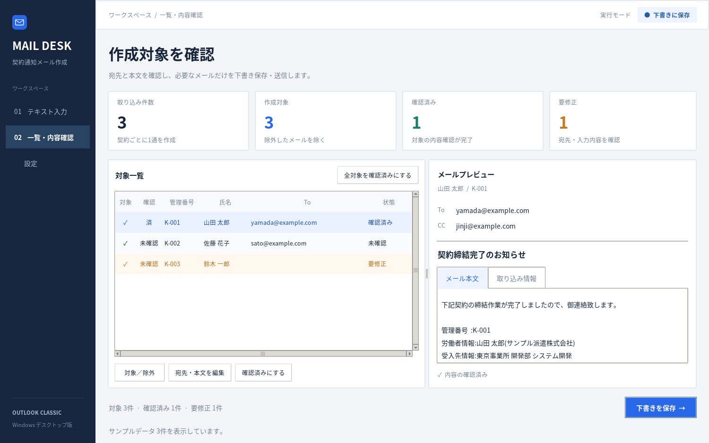

# Mail Desk — 契約通知メール作成アプリ

Windows専用のPythonデスクトップアプリです。貼り付け・txt読み込みから契約通知メールの対象一覧を作り、内容を確認して従来版Outlookに下書きを保存、または送信します。

## 画面

左のメニューで入力・一覧確認・設定を切り替えます。一覧画面は、対象件数・確認済み件数・要修正件数を上部に表示し、左に対象一覧、右にメールのプレビューを表示します。要修正の行を色で区別し、上部の実行モード表示で下書き保存／送信を確認できます。一覧の「対象」列はクリックで切り替えられます。



[入力画面](docs/previews/input.png) / [設定画面](docs/previews/settings.png)

画像はサンプルデータで実際のPython/Tk画面をLinux上で起動・撮影したものです。Windowsではフォントなどの表示に多少の差があります。画像の件名は表示例で、実際の初期値は空欄です。

## 導入と起動

1. Windowsに **Python 3.11以降**をインストールします。Python Launcher（`py`コマンド）も有効にしてください。
2. **従来版Outlook（classic）**でメールアカウントを設定し、通常のメール作成・送信ができる状態にします。
3. このフォルダーを展開し、初回に `setup.bat` をダブルクリックします。パッケージの取得にはインターネット接続が必要です。
4. `start.bat` をダブルクリックして起動します。

コマンドで導入する場合:

```powershell
py -3 -m venv .venv
.venv\Scripts\python.exe -m pip install -r requirements.txt
.venv\Scripts\python.exe main.py
```

新しいOutlookは対象外です。送信には従来版Outlookの既定アカウントを使用します。Outlookや組織の設定によっては、操作時に確認ダイアログが表示される場合があります。

## onedir形式のEXEを作成する

**Windows上で `build_exe.bat` をダブルクリック**します。必要なパッケージをインストールした後、PyInstallerでビルドします。初回はPython 3.11以降とインターネット接続が必要です。

次のファイルを同梱しています。

- `build_exe.bat`: 環境準備からビルドまで実行するバッチ
- `build_exe.py`: PyInstaller実行・サンプルの同梱・配布用ZIPの作成
- `OutlookMailDesk.spec`: onedir構成、コンソール非表示、アプリアイコン、COM関連モジュールの収集設定
- `requirements-build.txt`: ビルド用依存パッケージ
- `bulk_mailer/assets/`: ウィンドウ・EXEに使うアプリアイコン

既存のPython環境から手動でビルドする場合:

```powershell
python -m pip install -r requirements-build.txt
python build_exe.py
```

ビルド結果は次の構成です。

```text
dist/
├─ OutlookMailDesk/
│  ├─ OutlookMailDesk.exe
│  ├─ _internal/           ← Python・ライブラリ・アセット
│  ├─ samples/
│  ├─ docs/                ← 画面画像・監査報告
│  └─ README.md
└─ OutlookMailDesk-windows-onedir.zip
```

`OutlookMailDesk-windows-onedir.zip` を配布し、展開後に `OutlookMailDesk.exe` を起動します。**EXEと `_internal` を含むフォルダー全体を配布してください。** 配布先へのPythonのインストールは不要で、従来版Outlookと設定済みのメールアカウントは必要です。

設定と処理記録は引き続き `%LOCALAPPDATA%\OutlookBulkMailer` に保存します。EXEの配置フォルダーには保存しません。Windows用EXEの作成はWindows上で行い、Linuxからのクロスビルドはしません。

## 初期設定

「設定」タブで次を指定し、「設定を保存して反映」を押します。

- **共通の件名**: 全員同じ件名です。未定の間は空欄で保存でき、本文のプレビューも利用できます。下書き作成・送信前には件名の入力が必要です。
- **宛先Excel**: `.xlsx` の先頭シートを読み込みます。**A列を氏名、B列をメールアドレスに固定**し、1行目の見出しは **A1に `氏名`、B1に `メールアドレス`** を入力してください。2行目以降に1人1行で登録します。C列以降は読み込み対象外です。数式ではなく文字列で入力してください。
- **共通のCC**: 全メールに適用します。改行、カンマ、セミコロンで複数のメールアドレスを区切れます。空欄も可能です。
- **実行方法**: 初期値は「下書きに保存」です。「送信する」に変更すると確認後に送信を要求します。
- **本文テンプレート**: `{氏名}` などの記号に取り込みデータを差し込みます。画面に全項目の記号を表示しています。通常の波括弧を表示したい場合は `{{` と `}}` を使います。

氏名の照合では、全角・半角の違いと空白の違いを吸収します。宛先が未登録、または氏名が重複して宛先が確定できない場合は、対象一覧に表示します。必要なメールアドレスを個別編集で指定するか、Excelを直して読み込み直し、設定を保存してください。

Excelの読み込みに成功すると、氏名とメールアドレスの対応表を**その場で `contacts.json` に保存**します。次回の起動はJSONから復元するため、元のExcelを移動・削除しても利用できます。**Excelを読み込み直すと、保存済み対応表は全件置換**され、今回のExcelにない宛先は残りません。空欄・破損・保存失敗などで取り込みが失敗した場合は、以前のJSONを保持します。

宛先JSONの保存と、件名・CCなどの設定保存は別です。読み込み後は「設定を保存して反映」で未実行メールへ反映し、内容を再確認してください。設定を保存せず終了しても、読み込み済みの宛先JSONは保存されています。Excelの内容を後から編集しただけではJSONは変わらず、明示的に読み込み直す必要があります。

旧版の設定が残っていて宛先JSONがまだない場合は、指定されたExcelを一度読み込んでJSONへ移行します。JSONが破損している場合はExcelへ自動で戻さずエラーを表示します。その場合は設定画面からExcelを読み込み直してください。

`samples/宛先サンプル.xlsx` と `samples/入力サンプル.txt` を使って、下書き保存までを試せます。サンプルのメールアドレスは例示用です。

## 入力テキスト

次の並びを1人分として繰り返します。先頭の空白行は取り除きます。各項目は1行で、項目間に空白行が必要です。「契約承認状態」の直後の不要行には空白行を挟みません。

```text
管理番号

2026/11/01 - 2027/03/31

事業所名

部署名

業務名

チーム名

氏名

派遣元

契約承認状態
不要行

不要行

次の人の管理番号
```

2つの不要行は読み飛ばします。最後の人の2つ目の不要行の後は、改行がなくても読み込めます。日付や空白行の位置が不正な場合は、行番号の目安を表示して入力全体の修正を求めます。一部を黙って取り込むことはありません。現在の形式では各項目は必須です。

txtはUTF-8（BOMあり・なし）、UTF-16（BOMあり）、CP932に対応します。入力後、画面上でテキストを編集できます。

取り込みの上限はtxt 10MiB、貼り付け500万文字、Excelの展開後サイズ100MiB、宛先表は見出しを除き10万行です。超過時は途中まで取り込まず、分割を求めます。氏名・本文・宛先などの不正な制御文字は拒否します。

## 確認から実行まで

1. テキストを貼り付けるか「txtを読み込む」を押します。
2. 「作成対象リストを作る」を押します。
3. 一覧の行を選ぶと、To・CC・件名・本文と、チーム名・契約承認状態を含む元データを確認できます。承認状態による自動除外はしません。
4. 必要に応じて「選択メールを編集」でTo・CC・本文を修正します。件名は設定画面で全員共通のものを変更します。
5. 対象外の行は「対象／除外を切替」で除外します。
6. 内容を確認して「選択を確認済みにする」または「全対象を確認済みにする」を押します。
7. 「下書きを保存」または「対象メールを送信」を押し、件数と実行方法を確認して実行します。

設定を保存すると、未実行メールの件名・CC・本文・宛先照合を更新します。個別編集した内容も更新され、確認済みが解除されます。

同じパスのExcelを読み直した場合も、設定の保存と内容の再確認が必要です。入力テキストを変更した場合は、対象リストを作り直すまで実行できません。

メールはプレーンテキストで1契約につき1通作成します。同じ氏名の契約が複数ある場合も管理番号ごとに別メールです。管理番号が重複する入力は修正が必要です。本文は指定のテンプレートをそのまま使い、Outlookの署名は自動付与しません。

## 実行結果と保存先

- 設定: `%LOCALAPPDATA%\OutlookBulkMailer\settings.json`
- 宛先対応表: `%LOCALAPPDATA%\OutlookBulkMailer\contacts.json`（氏名・メールアドレス・元Excelのパス、最大100MiB）
- 処理記録: `%LOCALAPPDATA%\OutlookBulkMailer\logs\*.jsonl`
- 入力した契約一覧と個別編集は、アプリ終了時には保存しません。

処理記録には実行日時（UTC）、管理番号、To、実行方法、処理状態、エラーを保存します。メール本文は保存しません。

「送信要求済み」はOutlookへの送信要求が完了した状態です。配信完了を保証する表示ではありません。Outlookがオフラインの場合などは送信トレイに残ることがあります。

途中でエラーが起きた場合は、その時点で停止します。完了した行と結果が不確定な行は再実行できません。未処理分だけを続けられます。結果が不確定なメールはOutlookの下書き・送信トレイ・送信済みと処理記録を確認してください。

リストの再作成・アプリ再起動後も、過去の処理記録を読み、**管理番号＋実行方法**が一致する行を「履歴あり」として対象から除外します。件名・本文・宛先を変えてもこの履歴は解除されません。「開始」の記録しか残っていない場合も結果不確定として扱います。下書き保存と送信は別の実行方法なので、下書き保存後に送信モードへ変えてリストを作り直すことはできます。

同じ処理記録フォルダーを使う複数起動間では、OSロックで実行を直列化します。別の実行が処理中なら、その場で停止します。履歴が壊れている・読めない場合も、新しいメールは作成・送信しません。

処理記録は再実行防止にも使うため、削除・移動しないでください。現在は履歴を解除するUIを設けていません。結果不確定な行を自動で再送する機能もありません。別のWindowsユーザーや別PCでは記録を共有しません。また、Outlookで手動送信した下書きの送信状態は追跡していません。

## 検証

```powershell
python -m unittest discover -s tests -v
```

テストでは入力の構造・日付・文字コード・Excel照合・本文・設定の保存・実行前の検証・途中エラー時の停止と処理記録を検証します。GUIでは、取り込み結果の表示、確認・除外、設定反映、モード表示、処理中の操作制限を検証します。GUIテストにはディスプレイが必要です。Outlookの保存・送信呼び分けはモックで確認します。

開発環境はLinuxです。サブエージェント3役による独立監査と修正後の再監査を実施し、GUIを含む115件のテストが成功しました。実際のTk画面も起動・撮影済みです。[最終監査報告](docs/FINAL_AUDIT.md)に指摘・修正・検証範囲をまとめています。

Windows上のEXEビルド・起動、WindowsでのOSロック、実際のOutlook COM連携は未検証です。導入時に対象WindowsでEXEをビルドし、少数データの下書き保存・宛先解決を確認する必要があります。

画面プレビューの再作成には、Pillowと利用可能なディスプレイを用意し、`python tools/preview_ui.py` を実行します。サンプルデータと一時設定のみを使い、Outlook操作は無効にしています。
